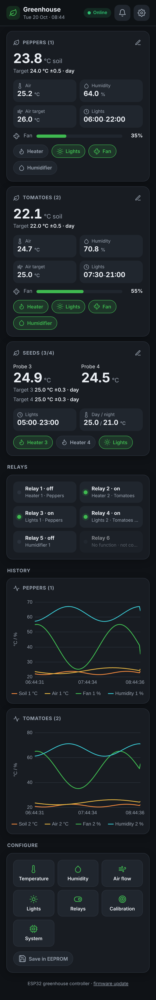
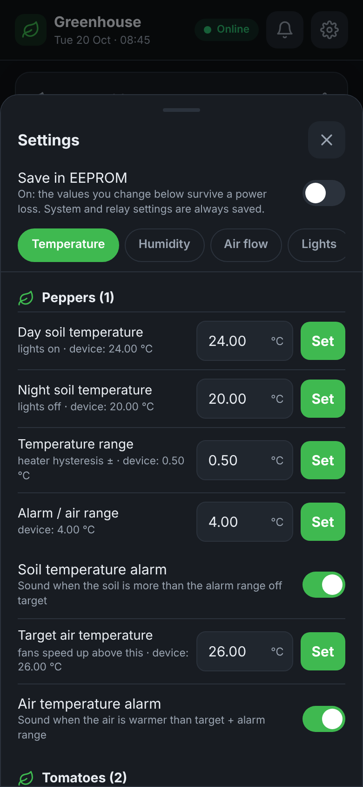
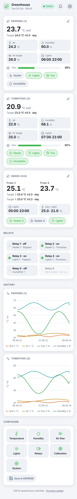

# Greenhouse

ESP32 (Wemos D1 mini32) controller for a small greenhouse: PT100 soil probes, DHT22 air
temperature/humidity, 6 relays (heaters, lights, humidifiers), 2 PWM fans, light schedules
and an optional DS3231 RTC, with a web interface over websockets.

| Dashboard | Settings | Light theme |
| --- | --- | --- |
|  |  |  |

## Works without internet (soft-AP mode)

When the stored wifi network can't be reached, the controller starts its own access point
`ESP32-AP`. Connect your phone to it and open `http://192.168.4.1`.

- The page, icons and graphs are served by the ESP32 itself; nothing comes from the internet.
- Captive portal: most phones show "sign in to network", which opens the page directly.
- `connected` / `offline` badge with automatic reconnect.
- With an external RTC that lost its time, the controller takes the time from your phone
  when there is no internet for NTP.

## Finding the controller

- `GET /info` returns `{"type":"greenhouse","name":"Greenhouse","id":"a1b2c3","version":"2.0","mode":"sta"|"ap","ip":"..."}`
- mDNS: `greenhouse-<id>.local`, service `_espdevice._tcp`

The companion app in the [BBQ-controller repository](https://github.com/Jory81/BBQ-controller/tree/claude/zealous-babbage-4j08al/companion-app)
uses this to find all your ESP32 devices.

## Flashing

Ready-made binaries are in [firmware/](firmware/) (also via `http://<ip>/update`). Or build
it yourself; `data/` must be uploaded to SPIFFS as well:

```
pio run -e wemos_d1_mini32 -t upload      # firmware
pio run -e wemos_d1_mini32 -t uploadfs    # web page (data/ folder)
```
